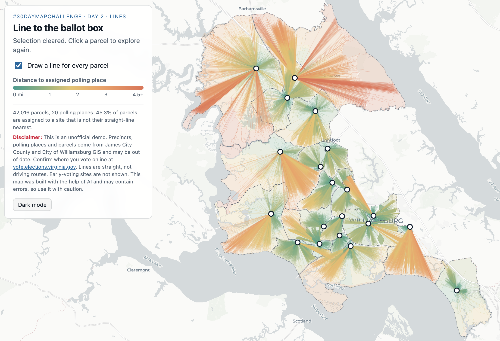

## #30DayMapChallenge Day 2: Lines

The 30-Day Map Challenge has been on my radar for some time now, and I’ve decided to attempt as many days as I have time for this year. Yesterday, I began working on a points map that quickly turned into a cluster and hotspot analysis, so I guess I’ll have to save that one for later this week.

With Election Day tomorrow, I built an interactive map for the Williamsburg and James City County area (home to my university, William & Mary). You can click your parcel to see which polling place you’re assigned to. Each line is the straight-line distance from your parcel to your assigned polling location.

With the help of Claude Code, I was able to toss together this fun interactive map in under an hour. I think I’ll be moving back to ArcGIS Pro for the next couple of days of polygons, clustering, and vintage maps. 

If you’re a W&M student and still aren’t sure whether you vote in the Matoaka or Stryker precinct, this might help! Please double-check with the official Virginia voter lookup before you head out. Let me know what you think!

Links to the interactive map and GitHub repo in the pinned comment.

### Map Visual

### Sources

| Source | Link |
| :--- | :---: |
| James City County Parcels | [Link](https://property.jamescitycountyva.gov/arcgis/rest/services/JCC/GIS_Data/FeatureServer/17) |
| James City County Polling Places | [Link](https://property.jamescitycountyva.gov/arcgis/rest/services/JCC/GIS_Data/MapServer/25) |
| James City County Voting Precincts | [Link](https://property.jamescitycountyva.gov/arcgis/rest/services/JCC/GIS_Data/MapServer/26) |
| Williamsburg Parcels | [Link](https://gis.williamsburgva.gov/server/rest/services/Tax_Parcels/MapServer/0) |
| Williamsburg Polling Sites | [Link](https://gis.williamsburgva.gov/server/rest/services/Voter_Precinct_Lookup_Map_MIL1/MapServer/0) |
| Williamsburg Voting Precincts | [Link](https://gis.williamsburgva.gov/server/rest/services/Voter_Precinct_Lookup_Map_MIL1/MapServer/1) |
| Basemap (CARTO, © OpenStreetMap contributors) | [Link](https://carto.com/basemaps) |
| MapLibre GL JS | [Link](https://maplibre.org/) |

### View it Online

| Source | Link |
| :--- | :---: |
| Interactive Map | https://jlzamary.github.io/ballot-box/ | 
| GitHub Repo | https://github.com/jlzamary/ballot-box | 
| LinkedIn Post | https://lnkd.in/p/emYYiEHv |
| X post | [Link](https://x.com/jack_zamary/status/2117372838629830781?a=AOI9MhLmZJgN90UZcPQ&s=20) |