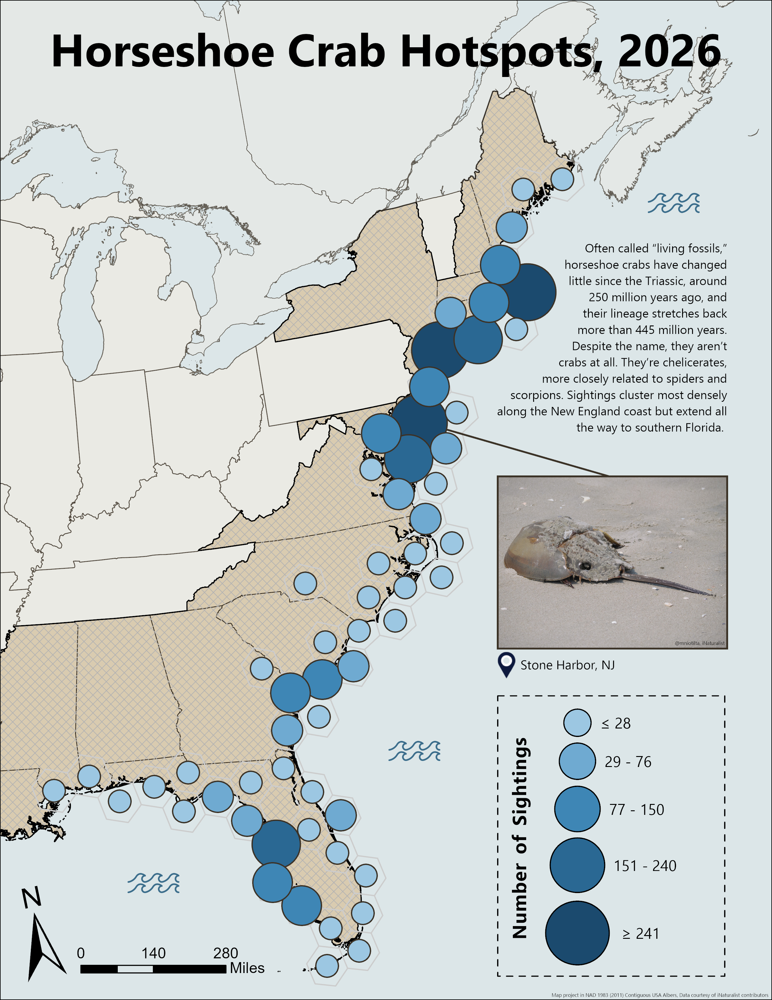

## #30DayMapChallenge Day 4: Clusters

Citizen science can play a huge role in understanding species patterns and collecting data at scale. iNaturalist does a great job of involving the community in data collection, and even better, its observations are available through Esri’s Living Atlas in ArcGIS Pro. Having done a lot of conservation-related research, I thought this was the perfect opportunity to work with some citizen science data and look into a crab that’s not actually a crab.

Often called “living fossils,” horseshoe crabs have changed little since the Triassic, around 250 million years ago. Despite the name, they’re chelicerates, more closely related to spiders and scorpions than to true crabs. Sightings cluster most densely along the New England coast but stretch all the way to southern Florida. Clusters like these partly reflect where people are looking, not just where the crabs are, which is worth keeping in mind with any citizen science dataset.

### Map Visual

### Sources

| Source | Link |
| :--- | :---: |
| iNaturalist Horseshoe Crab Observations | [Link](https://www.inaturalist.org/observations?subview=map&taxon_id=48309) | 