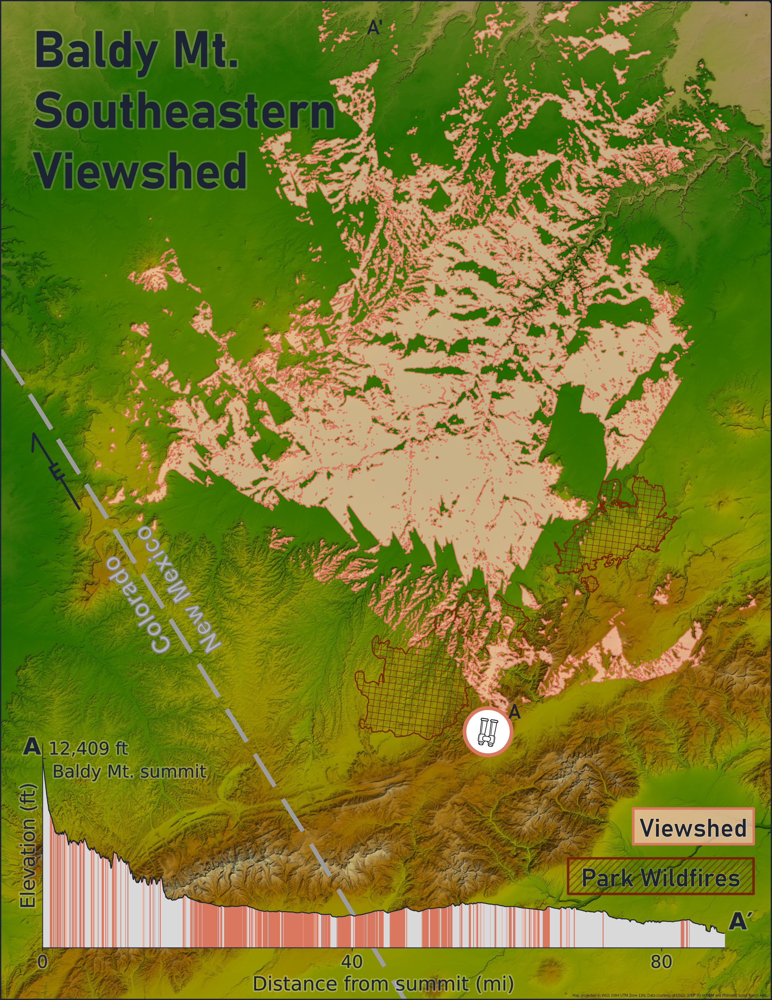

## #30DayMapChallenge Day 5: Sight

I’d never made a viewshed map or used ArcGIS Pro’s visibility tools before, so this felt like the perfect opportunity to try. I chose a place with one of the most expansive views I’ve ever seen and one tied to a very memorable experience.

At 12,441 feet (3,792 m), Baldy Mountain is the highest point in the Cimarron Range of the Sangre de Cristo Mountains, within Philmont Scout Ranch. I first visited Philmont with my Scout troop the summer before my freshman year of high school. Summiting Baldy was a highlight of the trip. The long descent back to camp that night... not so much.

The map shows everything visible from the summit looking southeast out across the Great Plains. Along the profile line, almost half of the terrain over nearly 90 miles can be seen from the top.

Map made in ArcGIS Pro | Graph made with Python | Data: USGS 3DEP and Philmont Scout Ranch

### Map Visual

### Sources

| Source | Link |
| :--- | :---: |
| Philmont Scout Ranch KML Data | [Link](https://www.philmontscoutranch.org/resources/conservation/gis/) | 
| USGS 3DEP DEM Data | [Link](https://www.arcgis.com/home/item.html?id=0383ba18906149e3bd2a0975a0afdb8e#overview) |