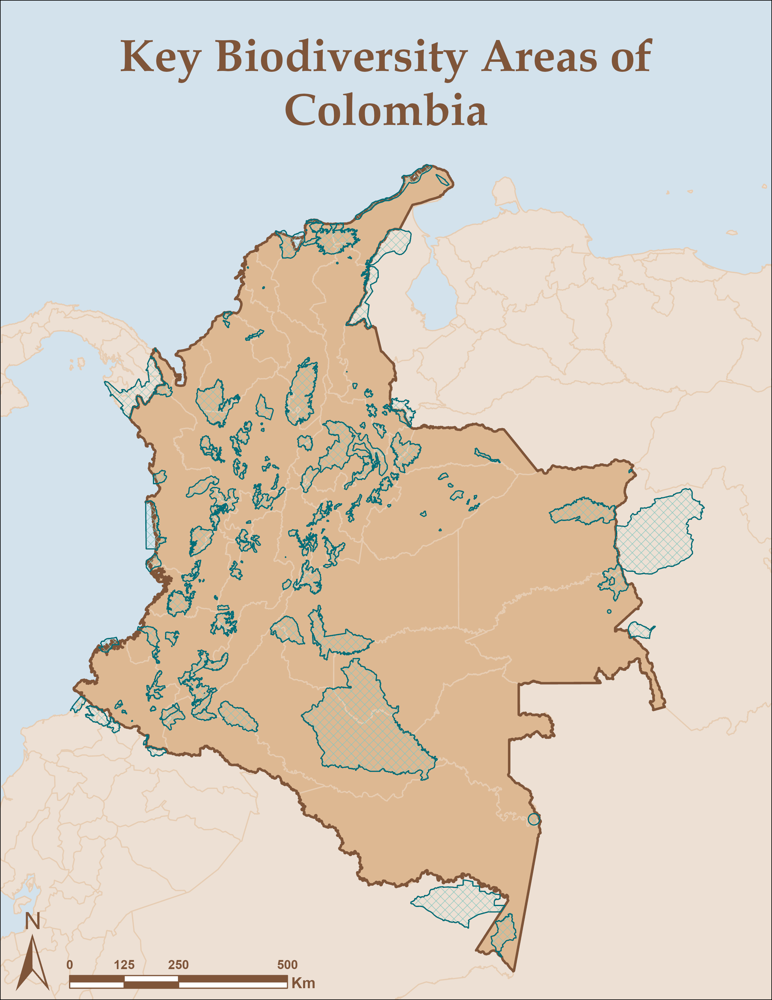

## #30DayMapChallenge Day 7: 10-Minute Map

Ever since taking conservation biology at William & Mary, I've known about the Key Biodiversity Area (KBA) dataset and have wanted to map part of it. With the data in polygon format and limited time for this map, I thought it would be a good opportunity to work with it.

Growing up, I spent four years in Colombia during late primary and early secondary school, and I remember watching the documentary Colombia: Magia Salvaje when it was released in 2015. The documentary highlighted Colombia's unique species and the importance of the region's biodiversity. This led me to focus on Colombia to display some of the KBA data.

Admittedly, this map took around 25 minutes to complete. I got the layers together in 10, then spent some extra time styling it. Given the time crunch, I think I did an alright job.

### Map Visual

### Sources

| Source | Link |
| :--- | :---: |
| geoBoundaries | [Link](https://www.geoboundaries.org/) |
| KBA Site Search | [Link](https://www.keybiodiversityareas.org/en/sites?view=map) | 