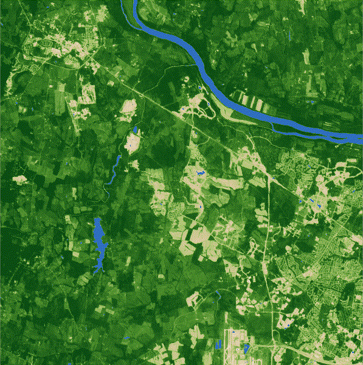

## #30DayMapChallenge Day 9: Urban-Rural

About a year ago I began working on my final project for an introduction to remote sensing class I was taking. For the project, I threw together a fun GIF in Google Earth Engine to highlight NDVI change over the course of 34 years around Ashburn, Virginia. I thought it would be cool to showcase here for the Urban-Rural theme, as it really shows how a more rural environment has become much more suburban over the course of three decades.

With the help of Claude, I fixed up some weaker parts of the code and ran it again in GEE. It now masks out water so it doesn’t skew NDVI, harmonizes Landsat 5 and Landsat 8/9 so the sensor switch doesn’t create false change, and uses a stricter cloud mask.

### Map Visual

### Sources

| Source | Link |
| :--- | :---: |
| Original YoutTube Tutorial | [Link](https://www.youtube.com/watch?v=Wsfis3IxBtc) |
| Landsat Image Collection (GEE) | [Link](https://developers.google.com/earth-engine/datasets/catalog/landsat) | 