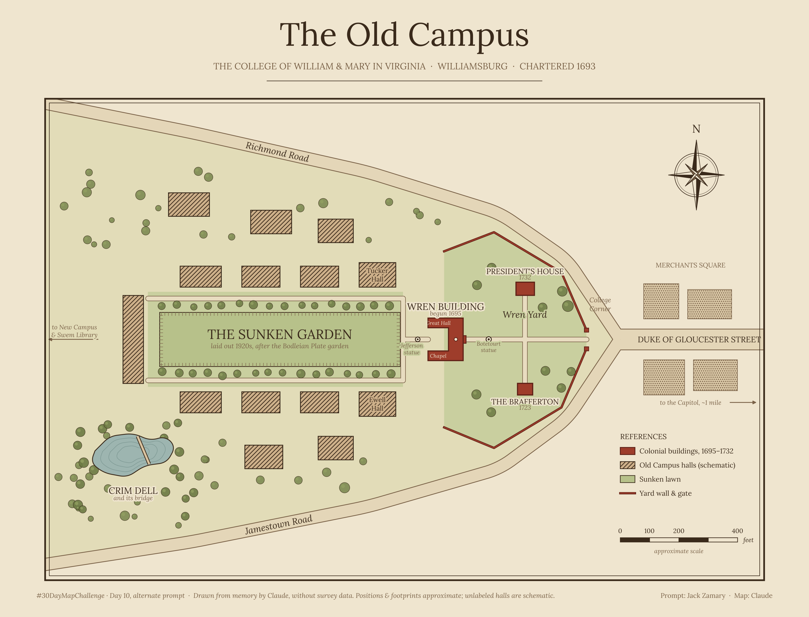
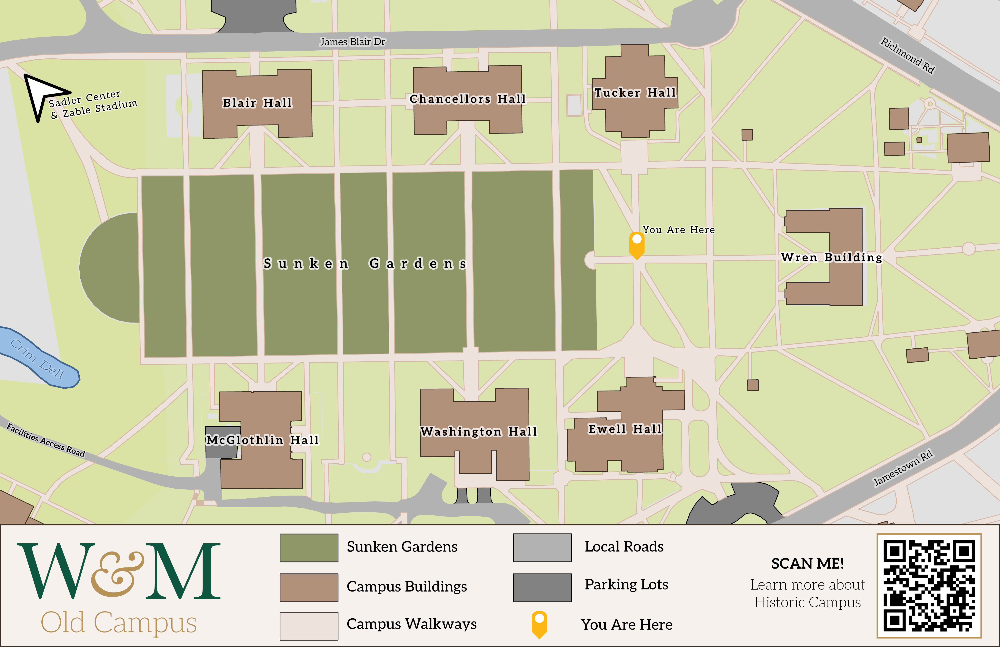

## #30DayMapChallenge Day 10: Prompting Only

For my Geovisualization and Cartography class last semester, one of our projects was to map a section of William & Mary’s campus. I chose Old Campus for the Wren Building and the Sunken Garden, two locations iconic to W&M’s history.

For the prompting-only challenge, I wanted to see how Claude would do with the same assignment. I kept the prompt simple: I asked Claude Opus 5.5 to make a static map of W&M’s Old Campus. It couldn’t pull building data from OpenStreetMap, so it drew the whole thing from memory in Python. The overall layout is pretty accurate, and the symbols are pretty sweet, though a fair amount of the positions and proportions are not so accurate. 

### Map Visual

<em>Map generated by Claude Opus 5.5 (medium)</em>

<em>My version of the map created in ArcGIS Pro</em>

### Sources

| Source | Link |
| :--- | :---: |
| Claude by Anthropic | [Link](claude.ai) |
| William and Mary CGA | [Link](https://www.wm.edu/as/cga/) | 